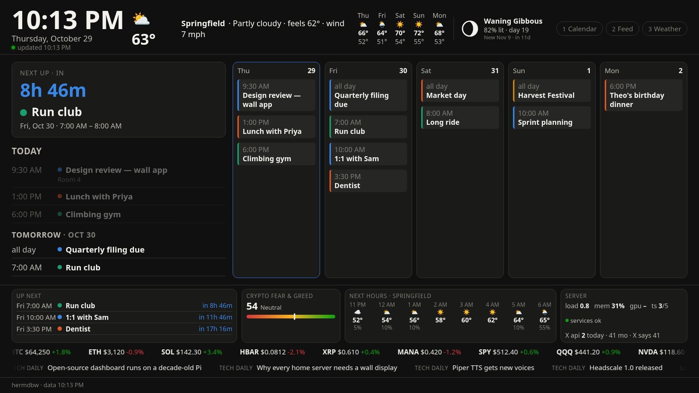
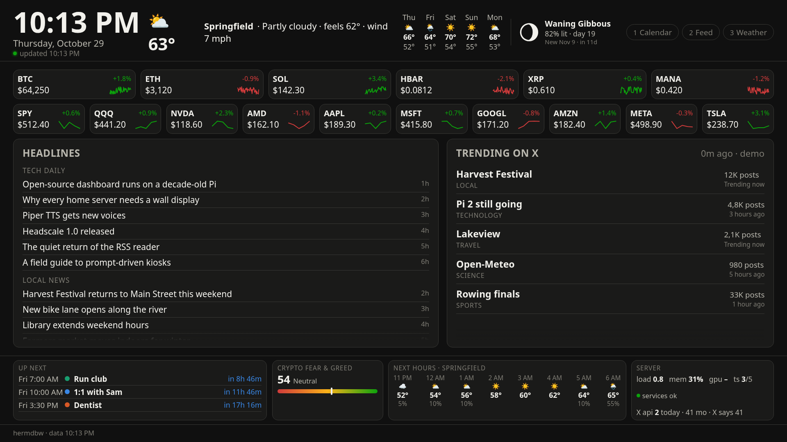
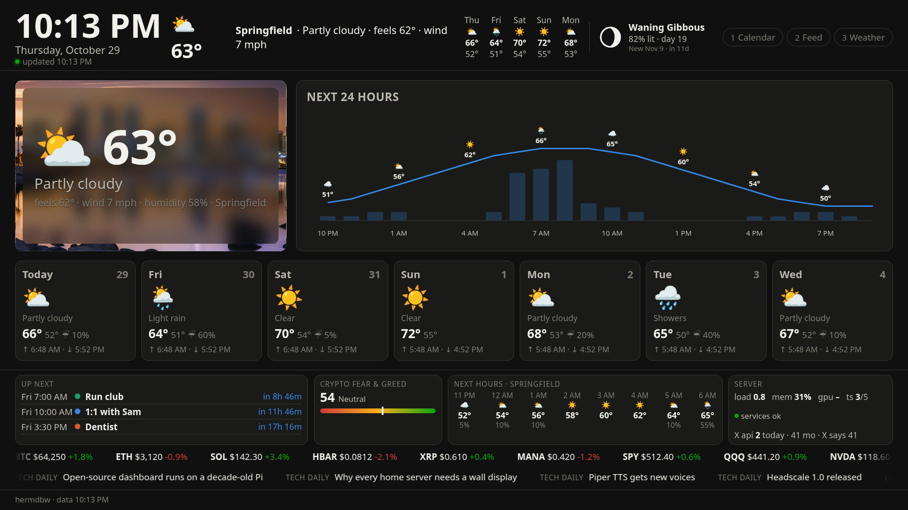
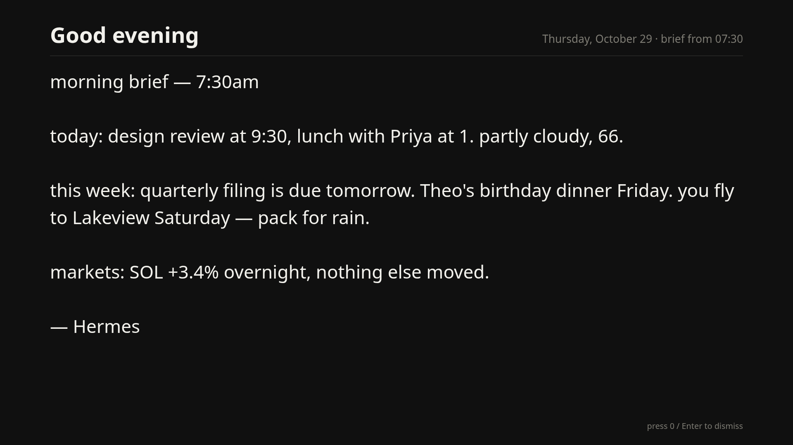

# hermdbw — Hermes Daily Brief Wall

A wall display for the things you'd otherwise check on your phone, driven by your own
[Hermes](https://github.com/NousResearch/hermes-agent) agent. Every calendar you have merged into one agenda, weather,
markets, headlines, what's trending on X — and a morning brief your agent writes and reads aloud in its own voice when
you press a button. Built for a Raspberry Pi on a TV, served by any Linux box on your network. No MagicMirror, no
Electron, no build step, and no API keys for the basics.



| Feed | Weather |
|---|---|
|  |  |

| Morning brief takeover | Flash alert from your agent |
|---|---|
|  |  |

## What's on the wall

- **Calendar** — next-up countdown, today's agenda rolling into the next days, and a five-day grid merging every iCal
  feed you give it (Google, Proton, iCloud, Outlook, holidays…), each in its own colour.
- **Feed** — crypto and stock tickers with 24 h change and sparklines, headlines from your RSS feeds, and what's trending
  on X from your own account.
- **Weather** — current conditions on a frosted-glass panel over a photo that changes with the weather and time of day,
  a 24-hour temperature and rain-chance chart, and a 7-day forecast with sunrise and sunset.
- **Dock on every page** — the next three events with countdowns, crypto Fear & Greed, the next eight hours, and a
  one-line health readout of the server; plus two tape lines (markets, headlines).
- **Header** — clock, freshness indicator, weather summary for your location, five-day outlook, moon phase.
- **Your agent** — a morning brief (text + spoken audio via [Piper](https://github.com/rhasspy/piper)) that takes the
  screen on a key press, and **flash alerts** your agent can post any time: "Lakeview trip in 7 days — 15° colder, pack
  a jacket", a birthday, a deadline collision, a weather warning — with a picture if it likes.

Pages slide, columns auto-scroll, and the whole board scales with the screen. A 2014 Raspberry Pi 2 runs it at ~25 % of
one core.

## Try it in two minutes (no accounts, no Pi)
```bash
git clone https://github.com/koktosen/hermdbdub && cd hermdbdub/server
python3 bin/demo-data.py /tmp/hermdbw-demo && HERMDBW_DATA=/tmp/hermdbw-demo PORT=8471 python3 serve.py
```
Open `http://localhost:8471/` — the whole wall running on fictional data (the screenshots above are exactly this).

## Quick start

You need: a Linux box that stays on (the **server**; a spare PC, a NUC, a Pi 4 — not the display Pi), a Raspberry Pi with
HDMI for the **wall**, and optionally a Hermes agent on the server.

**1. Server**
```bash
git clone https://github.com/koktosen/hermdbdub && cd hermdbdub
bash server/install.sh            # venv, config.yaml from the example, systemd --user units, `wallctl`
```
Then edit `server/config.yaml`: set `location.lat/lon` and paste your calendar URLs (the comments say where each one
comes from), or let your agent do it later. Open port 8470 to your LAN/tailnet if you run a firewall. Visit
`http://<server>:8470/` from any browser — the wall is just a web page.

**2. Wall (Raspberry Pi)**
Flash Raspberry Pi OS **Lite** (32-bit for Pi 1/2, 64-bit for Pi 3 and newer) with Raspberry Pi Imager, enabling SSH
and Wi-Fi in its settings, boot it, then:
```bash
scp pi/bootstrap-pi.sh <user>@<pi>:~ && ssh <user>@<pi> 'bash bootstrap-pi.sh http://<server-ip>:8470/ && sudo reboot'
```
It comes up full-screen on HDMI with no desktop, and keeps itself patched: daily unattended security updates with an off-hours reboot only when one is required. Details and troubleshooting: [`pi/README.md`](pi/README.md).

**3. Hermes agent (optional, but the point)**
```bash
bash hermes/install-hermes.sh     # installs the `wall-brief` skill + creates the morning-brief and X-trends cron jobs
```
Put the printed job ids into `server/config.yaml`, install Piper and set `piper_voice`, and start a new chat with your
agent so it picks up the skill. From then on: "put my work calendar on the wall", "drop the crypto fear tile",
"play my brief on the wall". See [`hermes/README.md`](hermes/README.md).

## Make it yours

Everything is `server/config.yaml`. The `layout:` section removes or reorders pages, ticker rows, feed columns, dock
tiles and tape lines; the wall adapts within a minute, no restart. `wallctl` (installed to `~/.local/bin`) makes
validated edits from the shell or from your agent:
```
wallctl show                          wallctl calendar add "Work" "https://…/basic.ics"
wallctl rss add "BBC" "https://…"     wallctl stocks set SPY QQQ NVDA
wallctl crypto set bitcoin ripple     wallctl location set 39.74 -104.99 --name "Denver"
wallctl refresh                       wallctl xusage
```
Colours come from a colour-blind-safe palette; pass `--color` to override. Full reference: [`server/README.md`](server/README.md).

## Keys (any USB keyboard, numpad or macro pad on the Pi)

| key | action |
|---|---|
| `1` `2` `3` … | jump to page *n* (numpad works with NumLock on or off) |
| `+` / `−`, `→` / `←` | next / previous page |
| `*` or `space` | pause / resume rotation |
| `0` or `Enter` | play the morning brief (full screen + audio); again to dismiss. Also dismisses a flash alert |
| `Esc` | dismiss |
| `/` or `r` | reload |

A cheap USB numpad needs no mapping. For a TV remote, a FLIRC USB receiver turns remote buttons into these keys.

## X (Twitter), optional

Trends and (optionally) your mentions come from X's official API through [`xurl`](https://github.com/xdevplatform/xurl),
authenticated as you. Register an X developer app, give it a callback of `http://localhost:8080/callback`, then on the
server: `xurl auth apps add wall --client-id <OAuth 2.0 Client ID> --client-secret <secret>` and
`xurl auth oauth2 --app wall`. Set `x_api.enabled: true`. X meters reads; the collector makes exactly one request per
enabled feature at each time in `x_api.times` (default 5/day) and `wallctl xusage` shows the exact count. The OAuth 2.0
Client ID ends in `:1:ci` — the shorter "API Key" is a different credential and will not work.

## Wall on a different network

Install Tailscale on the Pi (`pi/tailscale-up.sh`; Headscale users set `LOGIN_SERVER=`), then
`bash pi/set-url.sh http://<server-tailnet-ip>:8470/`. The kiosk launcher waits for the URL to answer, so it recovers on
its own after moves and outages.

## How it works

```
server/collectors/*.py  --(systemd --user timers)-->  server/data/*.json  <--  web/ (vanilla HTML/JS/CSS)  <--  serve.py :8470
                                                                                           ^
pi: cog (WPE WebKit) full-screen on KMS, polls the JSON every 60 s -------------------------┘
```
Collectors are small Python scripts (iCal via `icalendar`, Open-Meteo, CoinGecko, Yahoo Finance, feedparser,
alternative.me, X via `xurl`, your agent's cron output). The page is static and polls `data/*.json`; animations are
composited transforms so a weak Pi stays cool. Two tiny HTTP endpoints let an agent drive the wall:
`POST /api/alert` and `GET /api/trigger?what=brief|dismiss`.

## Layout of this repo

```
server/   collectors, web page, install.sh, wallctl, config.yaml.example
pi/       bootstrap-pi.sh, set-url.sh, tailscale-up.sh, cloud-init examples
hermes/   wall-brief skill, install-hermes.sh, cron prompts
docs/     screenshots
```

## Status

Built in a weekend for one household and shared as-is under the MIT license. Issues and pull requests welcome. Screenshots and the demo use fictional data.
